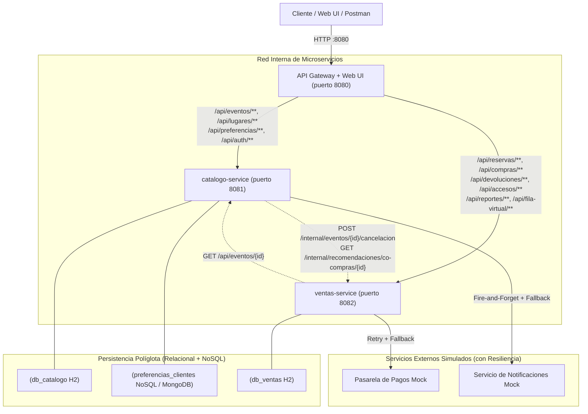

# TicketYa - Plataforma de Venta de Entradas (TUDAI - UNICEN)

**Trabajo Práctico de Arquitectura Web (2026) - Sistema Completo (Entrega 1 + Entrega 2)**

---

## Arquitectura del Sistema

El sistema está diseñado bajo una arquitectura de microservicios con Spring Boot, API Gateway (que además sirve la **Interfaz Gráfica Web**), persistencia relacional independiente por servicio (H2 file-based), almacenamiento documental NoSQL para preferencias de clientes (MongoDB / JSON Document Store), autenticación con JWT (HS256), cache con TTL, resiliencia y trazabilidad distribuida (`X-Correlation-Id`).



---

## Microservicios y Puertos

| Microservicio | Puerto | Responsabilidad Principal |
|---|---|---|
| **api-gateway** | `8080` | Punto de entrada único, ruteo a servicios, **Interfaz Gráfica Web** y Swagger UI unificado |
| **catalogo-service** | `8081` | Lugares, Sectores, Eventos, búsqueda multicriterio, Cache, Preferencias NoSQL, Recomendaciones, Notificaciones y Auth JWT |
| **ventas-service** | `8082` | Reservas temporales (10 min), Fila Virtual, No doble venta, Pagos con Resiliencia, QR, Control de Acceso QR y Reportes |

---

## Instrucciones de Ejecución

### Opción A: Levantar todo el sistema con Docker Compose (Entrega 2)

```powershell
docker compose up --build
```
Esto levanta en contenedores separados: `mongodb-preferencias` (`:27017`), `catalogo-service` (`:8081`), `ventas-service` (`:8082`) y `api-gateway` (`:8080`).

### Opción B: Ejecución Local (en terminales separadas, requiere Java 17+)

1. **Catalogo Service:**
```powershell
cd catalogo-service
.\mvnw spring-boot:run
```

2. **Ventas Service:**
```powershell
cd ventas-service
.\mvnw spring-boot:run
```

3. **API Gateway:**
```powershell
cd api-gateway
.\mvnw spring-boot:run
```

---

## Interfaz Gráfica Web (UI del Cliente, Organizador y Control de Acceso)

Con los 3 servicios levantados, abrir en el navegador:
👉 **http://localhost:8080/** (o `http://localhost:8080/index.html`)

La interfaz gráfica consume todas las APIs a través del API Gateway (`:8080`) y permite:
1. **Cargar Datos Demo con 1 clic** (crea lugares con sectores numerados y campo, y publica eventos normales y de alta demanda).
2. **Autenticarse con JWT (`POST /api/auth/login`)** y alternar entre usuarios (`cliente-1`, `cliente-2`, `org-1`, `admin-1`, `acceso-1`).
3. **Buscar eventos por múltiples criterios** (texto libre, ciudad, tipo, participante y orden por fecha, menor precio o relevancia).
4. **Elegir sector y asientos, ingresar a la Fila Virtual en eventos de alta demanda, crear reserva temporal (10 min) y pagar** (incluyendo simulación de reintento resiliente o rechazo de pago).
5. **Ver Mis Entradas con su Código QR dibujado en pantalla** y solicitar devoluciones.
6. **Configurar Preferencias en base NoSQL**, ver recomendaciones personalizadas y bandeja de notificaciones.
7. **Escanear códigos QR en el ingreso (`PERSONAL_ACCESO`)** y consultar los **Reportes por sector del Organizador** con barras de ocupación y recaudación.

---

## Documentación Técnica y Colecciones de Prueba

* **Diseño, Arquitectura, Decisiones Tecnológicas e Informe de Carga:** [docs/arquitectura.md](docs/arquitectura.md)
* **Plan de Prueba de Carga JMeter:** [docs/ticketya-compra-load-test.jmx](docs/ticketya-compra-load-test.jmx)
* **Features y User Stories (F1 a F12 / US-01 a US-23):** [docs/user-stories.md](docs/user-stories.md)
* **Listado de Endpoints (Entrega 1 + Entrega 2):** [docs/endpoints.md](docs/endpoints.md)
* **Colección de Postman Actualizada (Entrega 1 + Entrega 2):** [docs/TicketYa-Entrega1.postman_collection.json](docs/TicketYa-Entrega1.postman_collection.json) y carpeta `postman/`

### Documentación OpenAPI (Swagger)
Con los servicios levantados, entrar a **http://localhost:8080/swagger-ui.html** y elegir `catalogo-service` o `ventas-service` arriba a la derecha.
