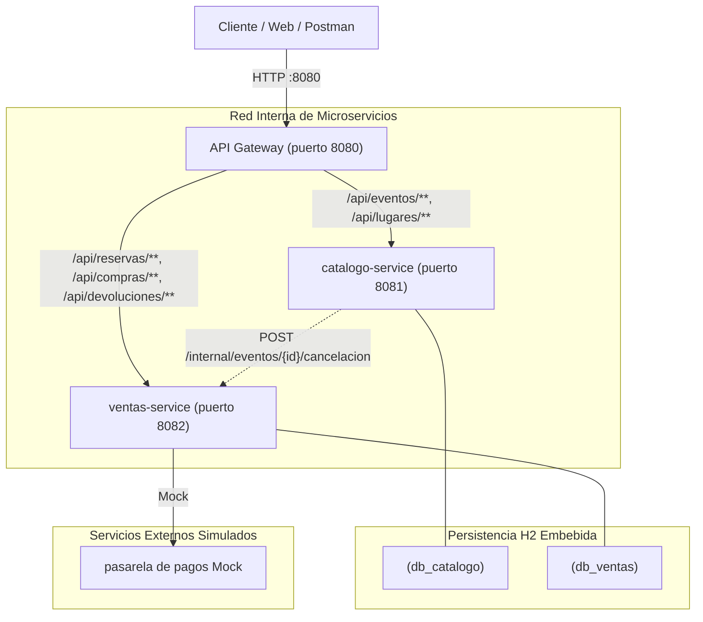

# TicketYa - Plataforma de Venta de Entradas (TUDAI - UNICEN)

**Trabajo Práctico de Arquitectura Web (2026) - Entrega 1 (Core del Sistema)**

---

## Arquitectura del Sistema

El sistema está diseñado bajo una arquitectura de microservicios con Spring Boot 3, API Gateway y persistencia relacional independiente por servicio (H2 file-based).



---

## Microservicios y Puertos

| Microservicio | Puerto | Responsabilidad Principal |
|---|---|---|
| **api-gateway** | `8080` | Punto de entrada único y ruteo hacia catálogo y ventas |
| **catalogo-service** | `8081` | Lugares, Sectores, Eventos y búsqueda multicriterio |
| **ventas-service** | `8082` | Reservas temporales (10 min), concurrencia, pagos, devoluciones y QR |

---

## Instrucciones de Ejecución

### Requisitos
* Java 17 o superior.
* Git.

### Levantar los servicios (en terminales separadas)

1. **Catalogo Service:**
```powershell
cd catalogo-service
.\mvnw spring-boot:run
```

2. **Ventas Service:**
```powershell
cd ventas-service
.\mvnw spring-boot:run
```

3. **API Gateway:**
```powershell
cd api-gateway
.\mvnw spring-boot:run
```

---

## Documentación Técnica Adicional

Los diagramas detallados exigidos por la cátedra se encuentran en el directorio [docs/arquitectura.md](docs/arquitectura.md):
* **Diagrama de Secuencia:** Flujo completo de compra, reserva, rechazo y expiración por timeout.
* **Diagrama Entidad-Relación (DER):** Esquema relacional, referencias lógicas entre microservicios y datos solapados.
* **Features y User Stories:** [docs/user-stories.md](docs/user-stories.md), con criterios de aceptación.
* **Listado de Endpoints:** [docs/endpoints.md](docs/endpoints.md), con parámetros, códigos de respuesta y ejemplos.
* **Colección de Postman y Datos de Prueba (Seed Data):** [docs/TicketYa-Entrega1.postman_collection.json](docs/TicketYa-Entrega1.postman_collection.json) (importar en Postman; incluye la carpeta `0. Datos de Prueba (Seed Data)` para poblar lugares, sectores y eventos, y carpetas para probar búsquedas, reservas, compras y devoluciones).

### Documentación OpenAPI (Swagger)
Con los servicios levantados, entrar a **http://localhost:8080/swagger-ui.html** y elegir `catalogo-service` o `ventas-service` arriba a la derecha.
