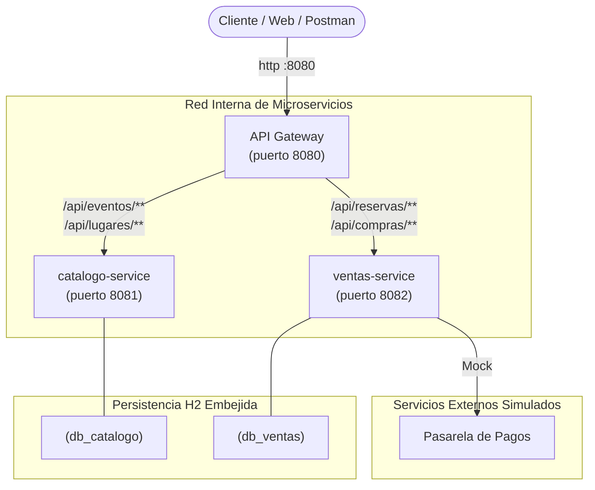
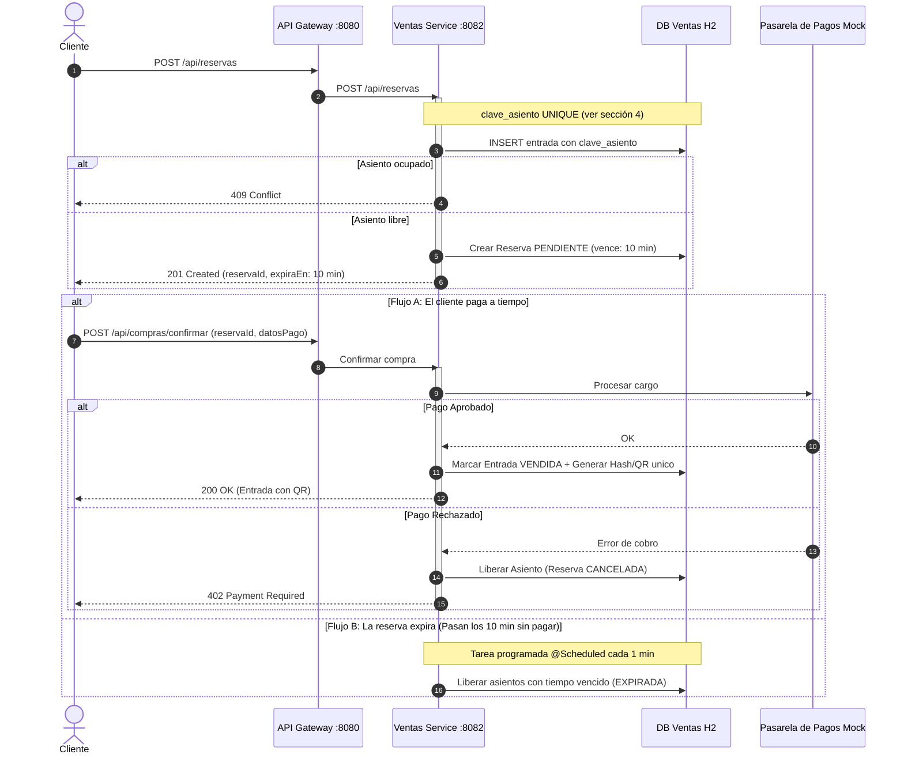
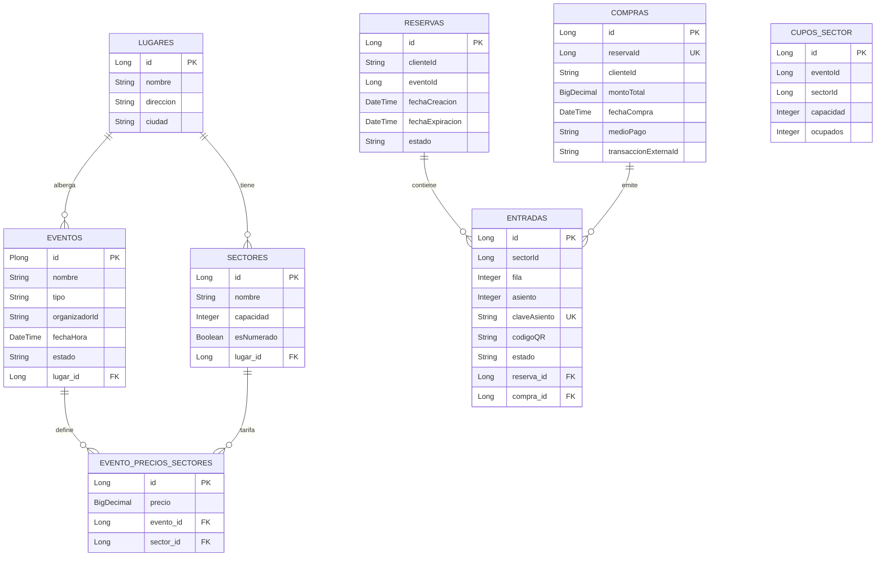

# TicketYa - Documentación de Diseño y Arquitectura (Entrega 1)

## 1. Diagrama de Módulos de la Arquitectura de Solución

---

## 2. Diagrama de Secuencia: Flujo de Compra de Entrada Numerada

---

## 3. Diagrama Entidad-Relación (DER) por Microservicio

`CUPOS_SECTOR` tiene `UNIQUE(eventoId, sectorId)`: una sola fila por sector no numerado de cada evento.

---

## 4. Mecanismo contra la Doble Venta

Requisito (punto 5 de la consigna): una entrada nunca se vende dos veces, aunque muchos clientes intenten comprar
el mismo asiento (o el último lugar de una zona) al mismo tiempo, aunque haya **varias instancias** de
`ventas-service`, y aunque un cliente reintente el pago por un problema de conexión.

### 4.1 Por qué no alcanzaba el bloqueo pesimista anterior

La versión anterior hacía `SELECT ... FOR UPDATE` (`@Lock(PESSIMISTIC_WRITE)`) buscando las entradas ocupadas de
ese asiento y, si no encontraba ninguna, lo reservaba. El problema: **si el asiento está libre, la consulta no
devuelve filas, y un `FOR UPDATE` sin filas no bloquea nada**. Dos transacciones simultáneas ven "libre" y las dos
insertan su entrada.

Lo comprobamos con un test: de 20 pedidos simultáneos de la fila 1 asiento 1, **10 obtuvieron la reserva**.

### 4.2 Asientos numerados: restricción de unicidad en la base

- Cada entrada RESERVADA o VENDIDA guarda `clave_asiento = "eventoId-sectorId-fila-asiento"`.
- La columna tiene una restricción `UNIQUE` (`uk_entrada_asiento_activo`).
- Cuando el lugar se libera (pago rechazado, reserva vencida, devolución aprobada) la clave se pone en `NULL`.
  Varios `NULL` no violan un `UNIQUE`, así que ese asiento se puede volver a vender.
- Si dos pedidos llegan juntos, la base deja insertar a uno solo. El otro recibe una
  `DataIntegrityViolationException`, se hace rollback y `GlobalExceptionHandler` responde **409 Conflict**.

### 4.3 Sectores no numerados ("Campo"): fila de cupo bloqueada

- Hay una fila por (evento, sector) en `cupos_sector` con `capacidad` y `ocupados`.
- La crea `CupoSectorInicializador` la primera vez que alguien compra en ese sector, en una transacción propia.
  Si dos la quieren crear a la vez, el `UNIQUE(evento_id, sector_id)` deja una sola.
- Al reservar se hace `SELECT ... FOR UPDATE` sobre esa fila. **Como la fila existe**, el bloqueo sí funciona: el
  segundo comprador espera a que termine el primero y ve el valor actualizado de `ocupados`.
- Si no alcanzan los lugares, responde **409**. Al liberar, se descuenta de `ocupados`.

### 4.4 Reintento del pago sin cobrar dos veces

- `confirmarCompra` bloquea la reserva (`findByIdForUpdate`): si llegan dos "Pagar" a la vez, se atienden de a uno.
- Si la reserva ya está CONFIRMADA, se devuelve **la misma compra** y no se vuelve a llamar a la pasarela.
- `compras.reserva_id` es `UNIQUE`: una reserva nunca puede generar dos compras.
- `@Transactional(noRollbackFor = ResponseStatusException.class)`: si el pago se rechaza o la reserva venció,
  la liberación de los lugares se guarda aunque se responda con error.

### 4.5 Por qué funciona con varias instancias del servicio

Las tres reglas (`UNIQUE` del asiento, `FOR UPDATE` del cupo y `UNIQUE` de la compra) las hace cumplir **la base de
datos**, no la memoria del proceso Java. Si levantamos dos o más instancias de `ventas-service` contra la misma
base, todas compiten por las mismas filas y restricciones, así que el resultado es el mismo.
Un `synchronized` o un lock en memoria, en cambio, solo protegería dentro de una instancia.

### 4.6 Cómo se prueba

`ventas-service/src/test/java/com/ticketya/ventas_service/concurrencia/DobleVentaConcurrenteTest.java` levanta el
contexto de Spring con una base H2 real (no mocks de repositorio) y lanza los pedidos en hilos que arrancan a la
vez (`CountDownLatch`). Solo se simula el catálogo, que es otro microservicio.

| Test | Escenario | Resultado esperado |
|---|---|---|
| `muchasComprasSimultaneasDelMismoAsiento` | 50 clientes piden fila 1 asiento 1 | 1 éxito y 49 rechazos |
| `muchasComprasSimultaneasDelUltimoLugarDeUnaZona` | Campo con capacidad 5 y 4 ocupados; 50 clientes piden 1 lugar | 1 éxito, `ocupados = 5` |
| `pagoRechazadoLiberaElAsiento` | Se rechaza el pago y otro cliente pide el mismo asiento | El segundo lo consigue |
| `reintentosSimultaneosDelPagoGeneranUnaSolaCompra` | 10 confirmaciones simultáneas de la misma reserva | 1 sola compra; todas devuelven el mismo id |

Además, `VentasServiceTest.reintentoDePagoNoCobraDosVecesTest` verifica que en un reintento no se llame a la pasarela.

Para correrlos: `cd ventas-service` y `./mvnw test` (en Windows `.\mvnw test`).
