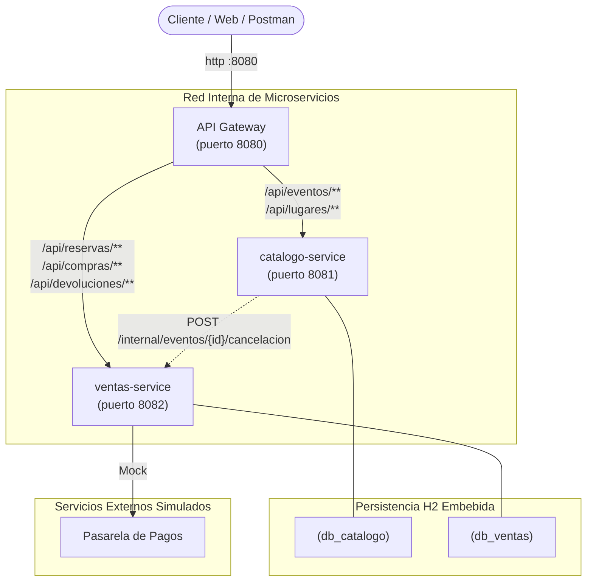
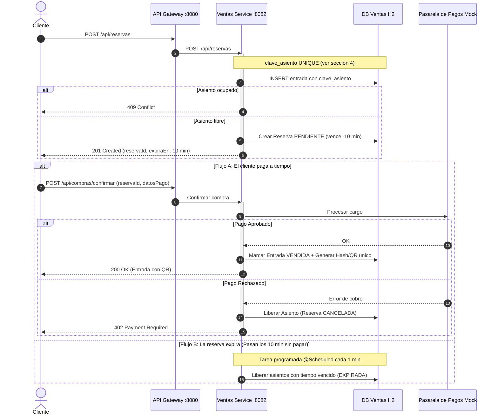
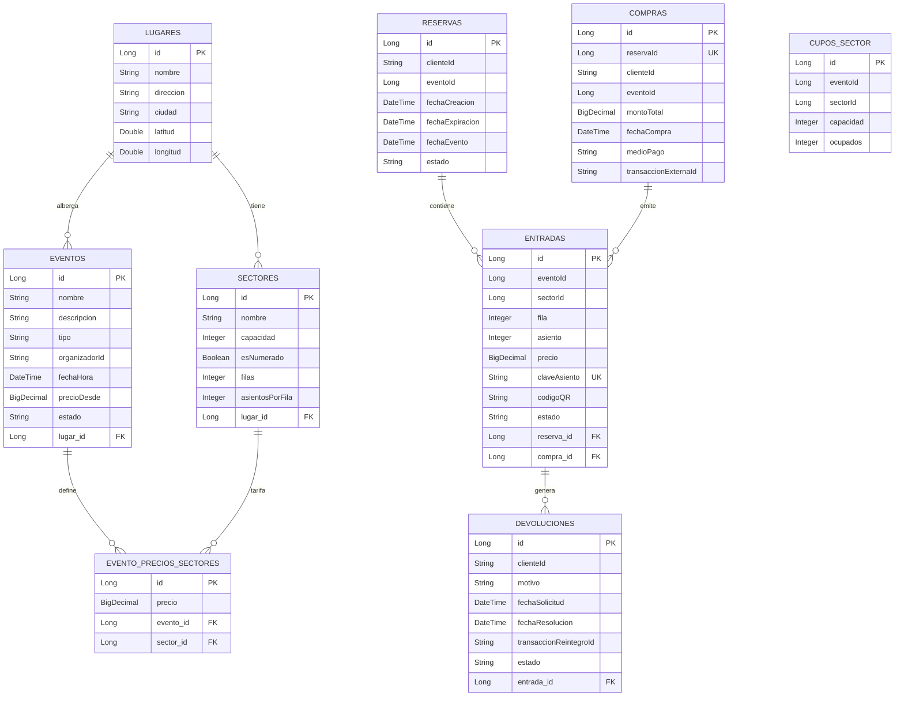
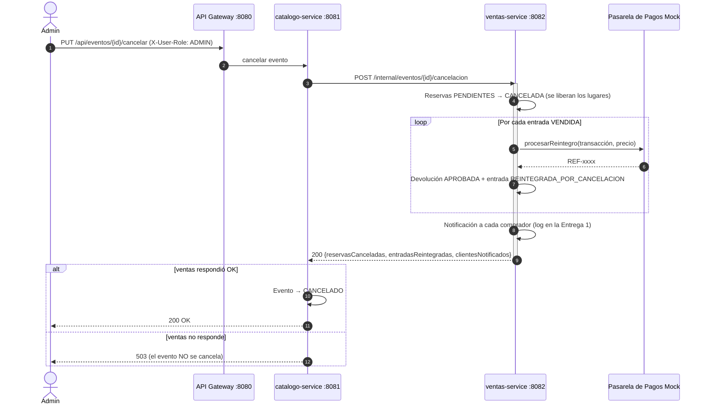

# TicketYa - Documentación de Diseño y Arquitectura (Entrega 1)

## 1. Diagrama de Módulos de la Arquitectura de Solución

---

## 2. Diagrama de Secuencia: Flujo de Compra de Entrada Numerada

---

## 3. Diagrama Entidad-Relación (DER) por Microservicio

`CUPOS_SECTOR` tiene `UNIQUE(eventoId, sectorId)`: una sola fila por sector no numerado de cada evento.

### 3.1 Separación por Base de Datos, Relaciones Lógicas entre Servicios y Datos Solapados

- **Tablas de `catalogo-service` (`db_catalogo`):** `LUGARES`, `SECTORES`, `EVENTOS` (junto con su colección `evento_participantes`) y `EVENTO_PRECIOS_SECTORES`.
- **Tablas de `ventas-service` (`db_ventas`):** `RESERVAS`, `ENTRADAS`, `COMPRAS`, `DEVOLUCIONES` y `CUPOS_SECTOR`.
- **Relaciones lógicas entre microservicios (sin FK física):** `ventas-service` referencia a las entidades de `catalogo-service` únicamente mediante sus identificadores (`eventoId` y `sectorId` en `RESERVAS`, `ENTRADAS`, `COMPRAS` y `CUPOS_SECTOR`), manteniendo desacoplados los esquemas relacionales de cada microservicio.
- **Entidades y datos solapados / desnormalizados entre bases:**
  - `RESERVAS.fechaEvento`: al crear una reserva temporal, `ventas-service` consulta el evento en `catalogo-service` y almacena una copia de `fechaHora` del evento en `fechaEvento`. Esto permite validar localmente la regla de negocio de devoluciones (hasta 72 horas antes del evento) sin depender de una llamada adicional a catálogo en el flujo de devolución.
  - `CUPOS_SECTOR.capacidad` y `ENTRADAS.precio`: `ventas-service` persiste el cupo del sector general y el precio pactado al momento de la reserva/compra como registro transaccional e histórico (inmutable aunque el catálogo cambie a futuro) y para poder aplicar `SELECT ... FOR UPDATE` sobre `CUPOS_SECTOR` dentro de su propia base de datos.

---

## 4. Mecanismo contra la Doble Venta

Requisito (punto 5 de la consigna): una entrada nunca se vende dos veces, aunque muchos clientes intenten comprar
el mismo asiento (o el último lugar de una zona) al mismo tiempo, aunque haya **varias instancias** de
`ventas-service`, y aunque un cliente reintente el pago por un problema de conexión.

### 4.1 Por qué no alcanzaba el bloqueo pesimista anterior

La versión anterior hacía `SELECT ... FOR UPDATE` (`@Lock(PESSIMISTIC_WRITE)`) buscando las entradas ocupadas de
ese asiento y, si no encontraba ninguna, lo reservaba. El problema: **si el asiento está libre, la consulta no
devuelve filas, y un `FOR UPDATE` sin filas no bloquea nada**. Dos transacciones simultáneas ven "libre" y las dos
insertan su entrada.

Lo comprobamos con un test: de 20 pedidos simultáneos de la fila 1 asiento 1, **10 obtuvieron la reserva**.

### 4.2 Asientos numerados: restricción de unicidad en la base

- Cada entrada RESERVADA o VENDIDA guarda `clave_asiento = "eventoId-sectorId-fila-asiento"`.
- La columna tiene una restricción `UNIQUE` (`uk_entrada_asiento_activo`).
- Cuando el lugar se libera (pago rechazado, reserva vencida, devolución aprobada) la clave se pone en `NULL`.
  Varios `NULL` no violan un `UNIQUE`, así que ese asiento se puede volver a vender.
- Si dos pedidos llegan juntos, la base deja insertar a uno solo. El otro recibe una
  `DataIntegrityViolationException`, se hace rollback y `GlobalExceptionHandler` responde **409 Conflict**.

### 4.3 Sectores no numerados ("Campo"): fila de cupo bloqueada

- Hay una fila por (evento, sector) en `cupos_sector` con `capacidad` y `ocupados`.
- La crea `CupoSectorInicializador` la primera vez que alguien compra en ese sector, en una transacción propia.
  Si dos la quieren crear a la vez, el `UNIQUE(evento_id, sector_id)` deja una sola.
- Al reservar se hace `SELECT ... FOR UPDATE` sobre esa fila. **Como la fila existe**, el bloqueo sí funciona: el
  segundo comprador espera a que termine el primero y ve el valor actualizado de `ocupados`.
- Si no alcanzan los lugares, responde **409**. Al liberar, se descuenta de `ocupados`.

### 4.4 Reintento del pago sin cobrar dos veces

- `confirmarCompra` bloquea la reserva (`findByIdForUpdate`): si llegan dos "Pagar" a la vez, se atienden de a uno.
- Si la reserva ya está CONFIRMADA, se devuelve **la misma compra** y no se vuelve a llamar a la pasarela.
- `compras.reserva_id` es `UNIQUE`: una reserva nunca puede generar dos compras.
- `@Transactional(noRollbackFor = ResponseStatusException.class)`: si el pago se rechaza o la reserva venció,
  la liberación de los lugares se guarda aunque se responda con error.

### 4.5 Por qué funciona con varias instancias del servicio

Las tres reglas (`UNIQUE` del asiento, `FOR UPDATE` del cupo y `UNIQUE` de la compra) las hace cumplir **la base de
datos**, no la memoria del proceso Java. Si levantamos dos o más instancias de `ventas-service` contra la misma
base, todas compiten por las mismas filas y restricciones, así que el resultado es el mismo.
Un `synchronized` o un lock en memoria, en cambio, solo protegería dentro de una instancia.

### 4.6 Cómo se prueba

`ventas-service/src/test/java/com/ticketya/ventas_service/concurrencia/DobleVentaConcurrenteTest.java` levanta el
contexto de Spring con una base H2 real (no mocks de repositorio) y lanza los pedidos en hilos que arrancan a la
vez (`CountDownLatch`). Solo se simula el catálogo, que es otro microservicio.

| Test | Escenario | Resultado esperado |
|---|---|---|
| `muchasComprasSimultaneasDelMismoAsiento` | 50 clientes piden fila 1 asiento 1 | 1 éxito y 49 rechazos |
| `muchasComprasSimultaneasDelUltimoLugarDeUnaZona` | Campo con capacidad 5 y 4 ocupados; 50 clientes piden 1 lugar | 1 éxito, `ocupados = 5` |
| `pagoRechazadoLiberaElAsiento` | Se rechaza el pago y otro cliente pide el mismo asiento | El segundo lo consigue |
| `reintentosSimultaneosDelPagoGeneranUnaSolaCompra` | 10 confirmaciones simultáneas de la misma reserva | 1 sola compra; todas devuelven el mismo id |

Además, `VentasServiceTest.reintentoDePagoNoCobraDosVecesTest` verifica que en un reintento no se llame a la pasarela.

Para correrlos: `cd ventas-service` y `./mvnw test` (en Windows `.\mvnw test`).

---

## 5. Cancelación de un Evento con Reintegro (Req. 7)

Cuando un administrador (o el organizador dueño) cancela un evento, todas sus entradas vendidas pasan a reintegro y se
avisa a los compradores. Como cada microservicio tiene su propia base, catálogo **no puede** modificar las entradas:
se lo pide a ventas por **REST síncrono** (`VentasClient`, mismo estilo que `CatalogoClient`).

Decisiones:

- **Primero ventas, después catálogo.** Si ventas no responde, el evento sigue como estaba y se responde 503. Así nunca
  queda un evento CANCELADO con entradas vendidas sin reintegrar. (En la Entrega 2 esto se reemplaza por una saga con
  mensajería asíncrona y compensaciones.)
- **Idempotente.** Si la llamada se repite, ventas no encuentra entradas VENDIDAS ni reservas PENDIENTES y no reintegra
  dos veces.
- Si un cliente ya había pedido la devolución de una entrada, se **aprueba esa misma solicitud** en lugar de crear otra.
- `/internal/**` **no está enrutado en el API Gateway**: desde afuera no se puede disparar una cancelación masiva.
- Un borrador nunca vendió entradas, así que se cancela sin llamar a ventas. Un organizador solo puede cancelar sus eventos (403).

Pruebas: `EventoServiceCancelacionTest` (catálogo) y `VentasServiceTest.cancelacionDeEventoReintegraEntradasTest` /
`cancelacionApruebaDevolucionYaSolicitadaTest` (ventas).

---

## 6. Búsqueda y Ordenamiento (Req. 9)

Filtros combinables (todos opcionales, se combinan con AND y solo se muestran eventos PUBLICADOS):
`q` (texto libre en nombre, descripción o participantes), `tipo`, `organizadorId`, `participante`, `ciudad`,
`fechaDesde`, `fechaHasta`. Se arma con la Criteria API de JPA (`EventoSpecification`).

| Orden | Ejemplo | Cómo funciona |
|---|---|---|
| Fecha | `/api/eventos?ciudad=Tandil&sort=fechaHora,asc` | `Pageable` de Spring Data (es el orden por defecto) |
| Precio | `/api/eventos?ciudad=Tandil&sort=precioDesde,asc` | `precioDesde` = precio del sector más barato, guardado en `eventos` al crear el evento |
| Relevancia | `/api/eventos?q=piojos&orden=relevancia` | Puntaje: texto en el nombre = 3, en un participante = 2, en la descripción = 1. A igual puntaje, primero el más próximo |

`precioDesde` es un dato **desnormalizado** (se podría calcular con un JOIN a `evento_precios_sectores`), pero tenerlo
en la tabla permite ordenar y paginar con una simple columna.

Pruebas: `EventoRepositoryBusquedaTest.busquedaOrdenadaPorPrecioTest` y `busquedaPorRelevanciaTest`.

---

## 7. Suspensión de Eventos (Req. 3)

Los administradores pueden suspender cualquier evento publicado o agotado, y después reactivarlo.

| Acción | Endpoint | Rol | Transición |
|---|---|---|---|
| Publicar | `PUT /api/eventos/{id}/publicar` | ORGANIZADOR (dueño) | BORRADOR → PUBLICADO |
| Suspender | `PUT /api/eventos/{id}/suspender` | ADMIN | PUBLICADO / AGOTADO → SUSPENDIDO |
| Reactivar | `PUT /api/eventos/{id}/reactivar` | ADMIN | SUSPENDIDO → PUBLICADO |
| Cancelar | `PUT /api/eventos/{id}/cancelar` | ADMIN u ORGANIZADOR (dueño) | cualquiera salvo CANCELADO / FINALIZADO → CANCELADO |

Con otro rol se responde `403`, y si el estado no permite la transición, `409`.

Mientras está suspendido, el evento no aparece en la búsqueda (solo se listan PUBLICADOS) y `ventas-service`
rechaza nuevas reservas con `409`: al crear la reserva ya consulta el evento a catálogo y ahora también mira su estado.
Las entradas ya vendidas se mantienen; si el evento no vuelve a publicarse, se cancela y se reintegran (sección 5).

Pruebas: `EventoServiceCancelacionTest.suspenderYReactivarEventoTest`, `noSePuedeSuspenderUnBorradorTest` y
`VentasServiceTest.reservaEnEventoSuspendidoTest`.
