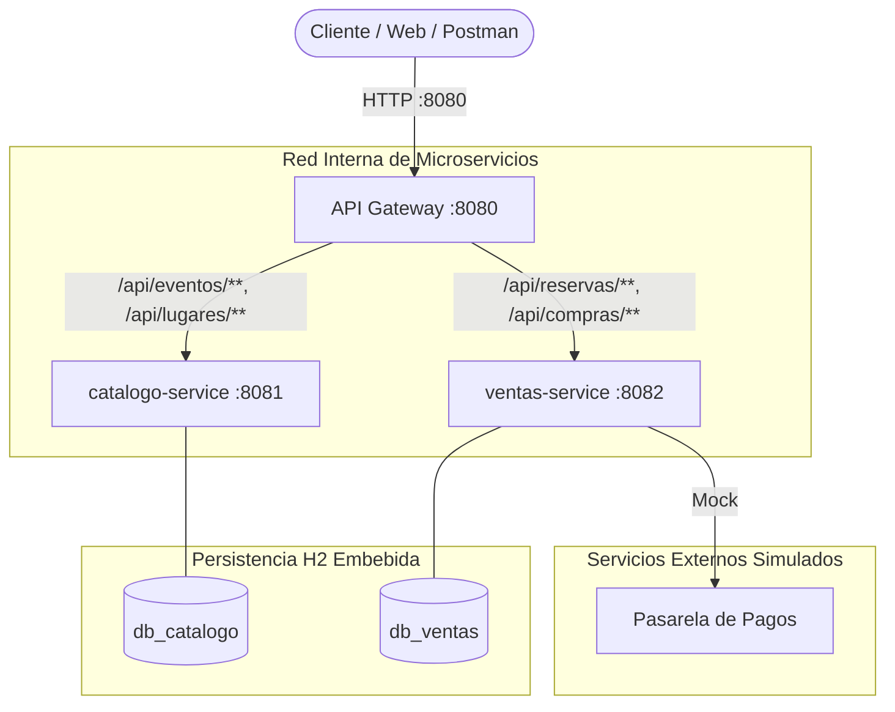
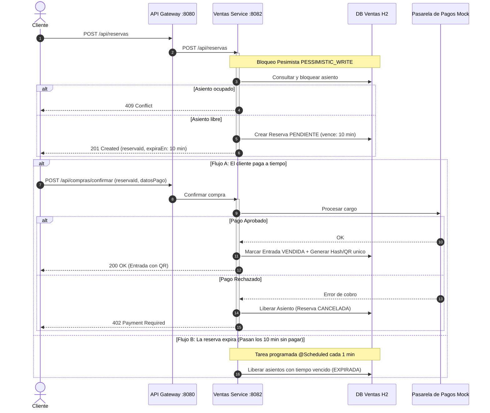
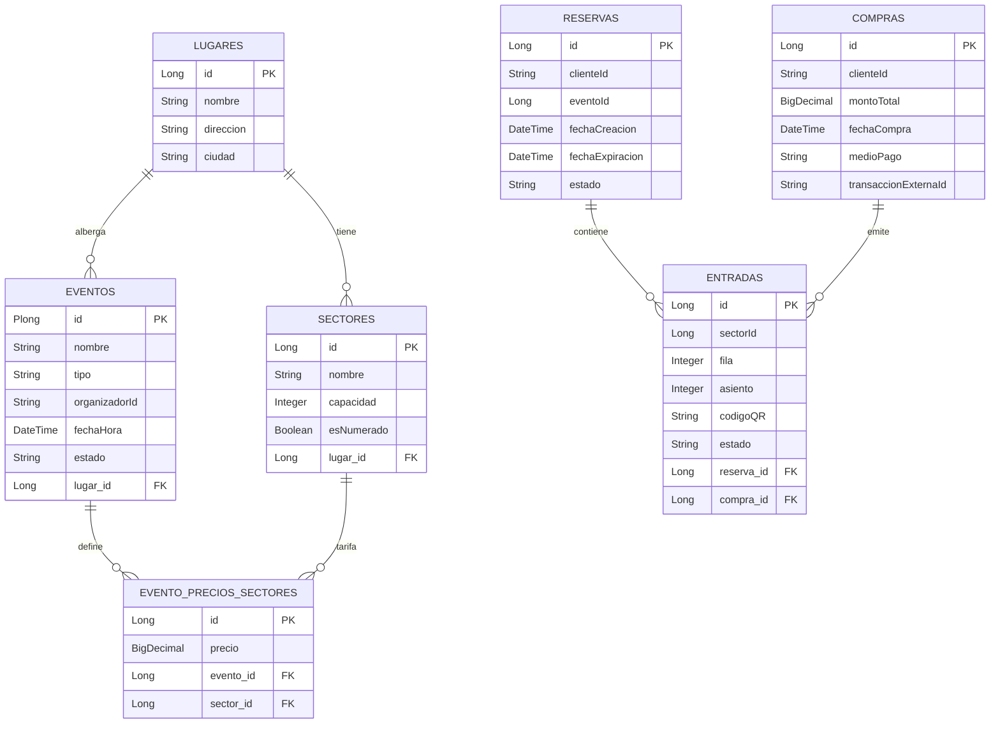

# TicketYa - Documentación de Diseño y Arquitectura (Entrega 1)

## 1. Diagrama de Módulos de la Arquitectura de Solución

---

## 2. Diagrama de Secuencia: Flujo de Compra de Entrada Numerada

---

## 3. Diagrama Entidad-Relación (DER) por Microservicio

