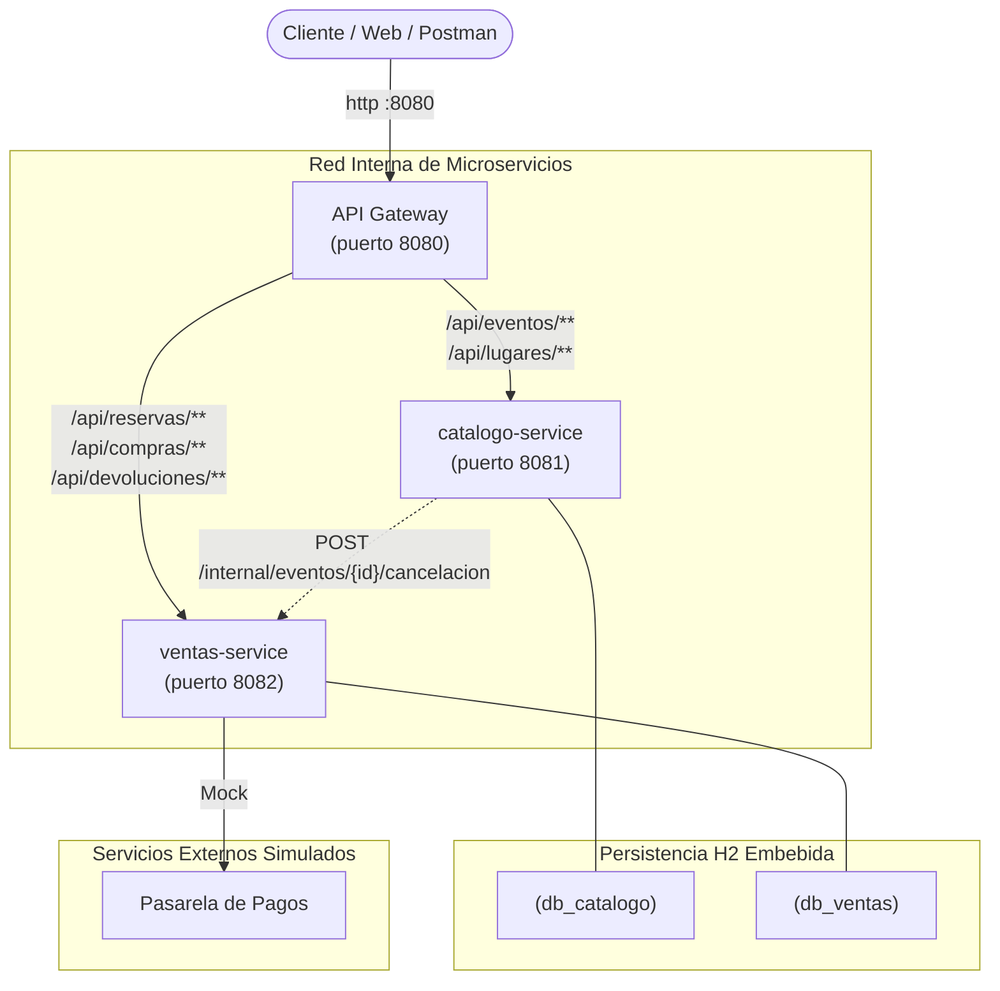
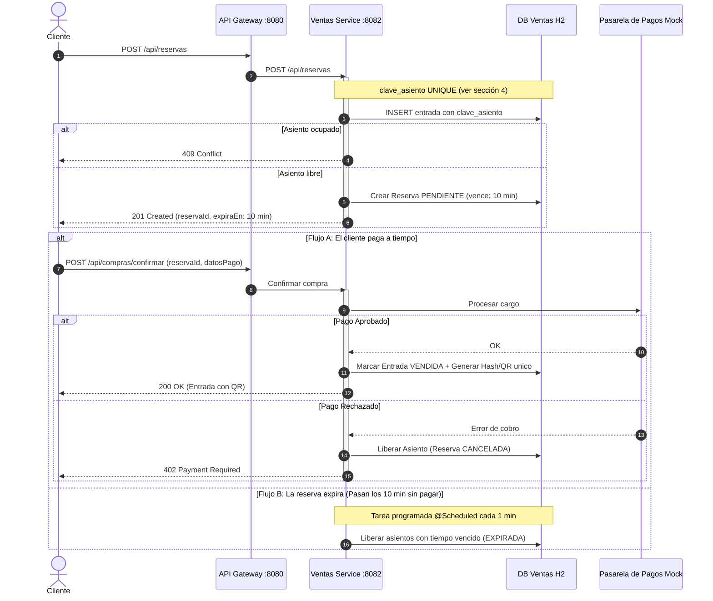
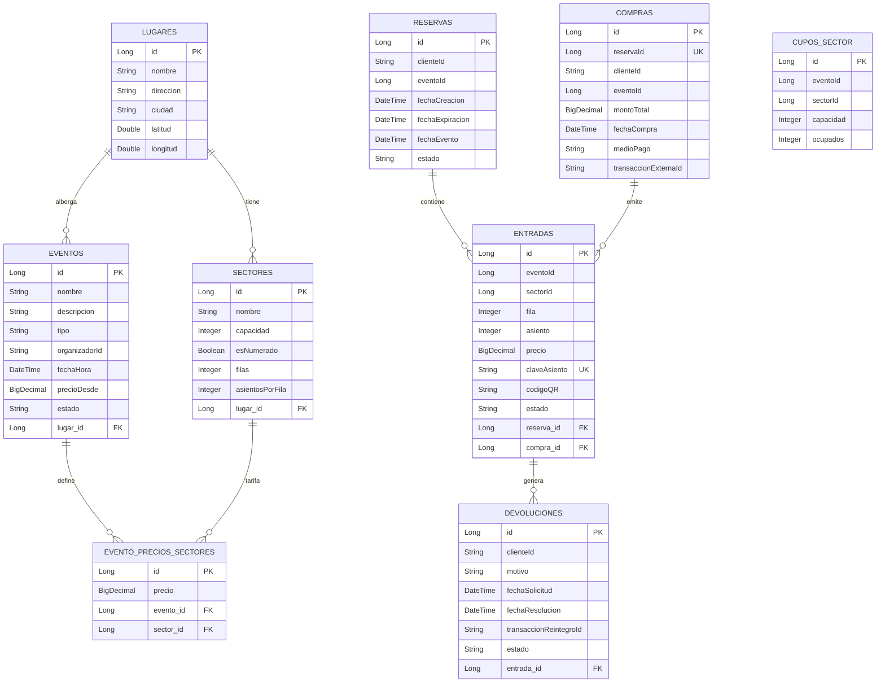
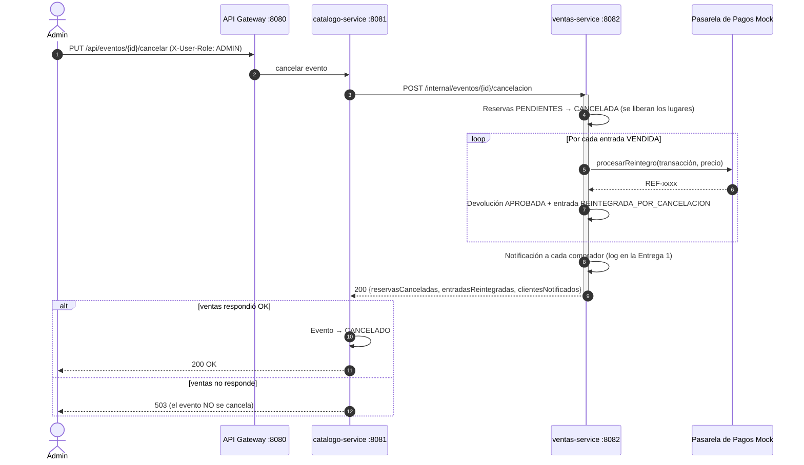

# TicketYa - Documentación de Diseño y Arquitectura (Entrega 1)

## 1. Diagrama de Módulos de la Arquitectura de Solución

---

## 2. Diagrama de Secuencia: Flujo de Compra de Entrada Numerada

---

## 3. Diagrama Entidad-Relación (DER) por Microservicio

`CUPOS_SECTOR` tiene `UNIQUE(eventoId, sectorId)`: una sola fila por sector no numerado de cada evento.

### 3.1 Separación por Base de Datos, Relaciones Lógicas entre Servicios y Datos Solapados

- **Tablas de `catalogo-service` (`db_catalogo`):** `LUGARES`, `SECTORES`, `EVENTOS` (junto con su colección `evento_participantes`) y `EVENTO_PRECIOS_SECTORES`.
- **Tablas de `ventas-service` (`db_ventas`):** `RESERVAS`, `ENTRADAS`, `COMPRAS`, `DEVOLUCIONES` y `CUPOS_SECTOR`.
- **Relaciones lógicas entre microservicios (sin FK física):** `ventas-service` referencia a las entidades de `catalogo-service` únicamente mediante sus identificadores (`eventoId` y `sectorId` en `RESERVAS`, `ENTRADAS`, `COMPRAS` y `CUPOS_SECTOR`), manteniendo desacoplados los esquemas relacionales de cada microservicio.
- **Entidades y datos solapados / desnormalizados entre bases:**
  - `RESERVAS.fechaEvento`: al crear una reserva temporal, `ventas-service` consulta el evento en `catalogo-service` y almacena una copia de `fechaHora` del evento en `fechaEvento`. Esto permite validar localmente la regla de negocio de devoluciones (hasta 72 horas antes del evento) sin depender de una llamada adicional a catálogo en el flujo de devolución.
  - `CUPOS_SECTOR.capacidad` y `ENTRADAS.precio`: `ventas-service` persiste el cupo del sector general y el precio pactado al momento de la reserva/compra como registro transaccional e histórico (inmutable aunque el catálogo cambie a futuro) y para poder aplicar `SELECT ... FOR UPDATE` sobre `CUPOS_SECTOR` dentro de su propia base de datos.

---

## 4. Mecanismo contra la Doble Venta

Requisito (punto 5 de la consigna): una entrada nunca se vende dos veces, aunque muchos clientes intenten comprar
el mismo asiento (o el último lugar de una zona) al mismo tiempo, aunque haya **varias instancias** de
`ventas-service`, y aunque un cliente reintente el pago por un problema de conexión.

### 4.1 Por qué no alcanzaba el bloqueo pesimista anterior

La versión anterior hacía `SELECT ... FOR UPDATE` (`@Lock(PESSIMISTIC_WRITE)`) buscando las entradas ocupadas de
ese asiento y, si no encontraba ninguna, lo reservaba. El problema: **si el asiento está libre, la consulta no
devuelve filas, y un `FOR UPDATE` sin filas no bloquea nada**. Dos transacciones simultáneas ven "libre" y las dos
insertan su entrada.

Lo comprobamos con un test: de 20 pedidos simultáneos de la fila 1 asiento 1, **10 obtuvieron la reserva**.

### 4.2 Asientos numerados: restricción de unicidad en la base

- Cada entrada RESERVADA o VENDIDA guarda `clave_asiento = "eventoId-sectorId-fila-asiento"`.
- La columna tiene una restricción `UNIQUE` (`uk_entrada_asiento_activo`).
- Cuando el lugar se libera (pago rechazado, reserva vencida, devolución aprobada) la clave se pone en `NULL`.
  Varios `NULL` no violan un `UNIQUE`, así que ese asiento se puede volver a vender.
- Si dos pedidos llegan juntos, la base deja insertar a uno solo. El otro recibe una
  `DataIntegrityViolationException`, se hace rollback y `GlobalExceptionHandler` responde **409 Conflict**.

### 4.3 Sectores no numerados ("Campo"): fila de cupo bloqueada

- Hay una fila por (evento, sector) en `cupos_sector` con `capacidad` y `ocupados`.
- La crea `CupoSectorInicializador` la primera vez que alguien compra en ese sector, en una transacción propia.
  Si dos la quieren crear a la vez, el `UNIQUE(evento_id, sector_id)` deja una sola.
- Al reservar se hace `SELECT ... FOR UPDATE` sobre esa fila. **Como la fila existe**, el bloqueo sí funciona: el
  segundo comprador espera a que termine el primero y ve el valor actualizado de `ocupados`.
- Si no alcanzan los lugares, responde **409**. Al liberar, se descuenta de `ocupados`.

### 4.4 Reintento del pago sin cobrar dos veces

- `confirmarCompra` bloquea la reserva (`findByIdForUpdate`): si llegan dos "Pagar" a la vez, se atienden de a uno.
- Si la reserva ya está CONFIRMADA, se devuelve **la misma compra** y no se vuelve a llamar a la pasarela.
- `compras.reserva_id` es `UNIQUE`: una reserva nunca puede generar dos compras.
- `@Transactional(noRollbackFor = ResponseStatusException.class)`: si el pago se rechaza o la reserva venció,
  la liberación de los lugares se guarda aunque se responda con error.

### 4.5 Por qué funciona con varias instancias del servicio

Las tres reglas (`UNIQUE` del asiento, `FOR UPDATE` del cupo y `UNIQUE` de la compra) las hace cumplir **la base de
datos**, no la memoria del proceso Java. Si levantamos dos o más instancias de `ventas-service` contra la misma
base, todas compiten por las mismas filas y restricciones, así que el resultado es el mismo.
Un `synchronized` o un lock en memoria, en cambio, solo protegería dentro de una instancia.

### 4.6 Cómo se prueba

`ventas-service/src/test/java/com/ticketya/ventas_service/concurrencia/DobleVentaConcurrenteTest.java` levanta el
contexto de Spring con una base H2 real (no mocks de repositorio) y lanza los pedidos en hilos que arrancan a la
vez (`CountDownLatch`). Solo se simula el catálogo, que es otro microservicio.

| Test | Escenario | Resultado esperado |
|---|---|---|
| `muchasComprasSimultaneasDelMismoAsiento` | 50 clientes piden fila 1 asiento 1 | 1 éxito y 49 rechazos |
| `muchasComprasSimultaneasDelUltimoLugarDeUnaZona` | Campo con capacidad 5 y 4 ocupados; 50 clientes piden 1 lugar | 1 éxito, `ocupados = 5` |
| `pagoRechazadoLiberaElAsiento` | Se rechaza el pago y otro cliente pide el mismo asiento | El segundo lo consigue |
| `reintentosSimultaneosDelPagoGeneranUnaSolaCompra` | 10 confirmaciones simultáneas de la misma reserva | 1 sola compra; todas devuelven el mismo id |

Además, `VentasServiceTest.reintentoDePagoNoCobraDosVecesTest` verifica que en un reintento no se llame a la pasarela.

Para correrlos: `cd ventas-service` y `./mvnw test` (en Windows `.\mvnw test`).

---

## 5. Cancelación de un Evento con Reintegro (Req. 7)

Cuando un administrador (o el organizador dueño) cancela un evento, todas sus entradas vendidas pasan a reintegro y se
avisa a los compradores. Como cada microservicio tiene su propia base, catálogo **no puede** modificar las entradas:
se lo pide a ventas por **REST síncrono** (`VentasClient`, mismo estilo que `CatalogoClient`).

Decisiones:

- **Primero ventas, después catálogo.** Si ventas no responde, el evento sigue como estaba y se responde 503. Así nunca
  queda un evento CANCELADO con entradas vendidas sin reintegrar. (En la Entrega 2 esto se reemplaza por una saga con
  mensajería asíncrona y compensaciones.)
- **Idempotente.** Si la llamada se repite, ventas no encuentra entradas VENDIDAS ni reservas PENDIENTES y no reintegra
  dos veces.
- Si un cliente ya había pedido la devolución de una entrada, se **aprueba esa misma solicitud** en lugar de crear otra.
- `/internal/**` **no está enrutado en el API Gateway**: desde afuera no se puede disparar una cancelación masiva.
- Un borrador nunca vendió entradas, así que se cancela sin llamar a ventas. Un organizador solo puede cancelar sus eventos (403).

Pruebas: `EventoServiceCancelacionTest` (catálogo) y `VentasServiceTest.cancelacionDeEventoReintegraEntradasTest` /
`cancelacionApruebaDevolucionYaSolicitadaTest` (ventas).

---

## 6. Búsqueda y Ordenamiento (Req. 9)

Filtros combinables (todos opcionales, se combinan con AND y solo se muestran eventos PUBLICADOS):
`q` (texto libre en nombre, descripción o participantes), `tipo`, `organizadorId`, `participante`, `ciudad`,
`fechaDesde`, `fechaHasta`. Se arma con la Criteria API de JPA (`EventoSpecification`).

| Orden | Ejemplo | Cómo funciona |
|---|---|---|
| Fecha | `/api/eventos?ciudad=Tandil&sort=fechaHora,asc` | `Pageable` de Spring Data (es el orden por defecto) |
| Precio | `/api/eventos?ciudad=Tandil&sort=precioDesde,asc` | `precioDesde` = precio del sector más barato, guardado en `eventos` al crear el evento |
| Relevancia | `/api/eventos?q=piojos&orden=relevancia` | Puntaje: texto en el nombre = 3, en un participante = 2, en la descripción = 1. A igual puntaje, primero el más próximo |

`precioDesde` es un dato **desnormalizado** (se podría calcular con un JOIN a `evento_precios_sectores`), pero tenerlo
en la tabla permite ordenar y paginar con una simple columna.

Pruebas: `EventoRepositoryBusquedaTest.busquedaOrdenadaPorPrecioTest` y `busquedaPorRelevanciaTest`.

---

## 7. Suspensión de Eventos (Req. 3)

Los administradores pueden suspender cualquier evento publicado o agotado, y después reactivarlo.

| Acción | Endpoint | Rol | Transición |
|---|---|---|---|
| Publicar | `PUT /api/eventos/{id}/publicar` | ORGANIZADOR (dueño) | BORRADOR → PUBLICADO |
| Suspender | `PUT /api/eventos/{id}/suspender` | ADMIN | PUBLICADO / AGOTADO → SUSPENDIDO |
| Reactivar | `PUT /api/eventos/{id}/reactivar` | ADMIN | SUSPENDIDO → PUBLICADO |
| Cancelar | `PUT /api/eventos/{id}/cancelar` | ADMIN u ORGANIZADOR (dueño) | cualquiera salvo CANCELADO / FINALIZADO → CANCELADO |

Con otro rol se responde `403`, y si el estado no permite la transición, `409`.

Mientras está suspendido, el evento no aparece en la búsqueda (solo se listan PUBLICADOS) y `ventas-service`
rechaza nuevas reservas con `409`: al crear la reserva ya consulta el evento a catálogo y ahora también mira su estado.
Las entradas ya vendidas se mantienen; si el evento no vuelve a publicarse, se cancela y se reintegran (sección 5).

Pruebas: `EventoServiceCancelacionTest.suspenderYReactivarEventoTest`, `noSePuedeSuspenderUnBorradorTest` y
`VentasServiceTest.reservaEnEventoSuspendidoTest`.

---

## 8. Base NoSQL para Preferencias, Recomendaciones y Notificaciones (Entrega 2 - Req. 10 y 11)

### 8.1 Justificación de Base de Datos NoSQL Documental (MongoDB / Colección Documental JSON)
Para almacenar las **preferencias de los clientes** (`PreferenciaClienteDocument`, colección `preferencias_clientes`) se eligió un **modelo documental NoSQL** en lugar de tablas relacionales normalizadas por tres razones arquitectónicas:
1. **Esquema flexible y estructura anidada:** Cada documento agrupa en una única unidad atómica (`_id`, `clienteId`, array de `tiposEvento`, array de `artistasFavoritos`, `ciudad` y `fechaActualizacion`), evitando múltiples tablas puente (`cliente_tipos_evento`, `cliente_artistas_favoritos`) y `JOIN`s innecesarios.
2. **Lectura y escritura por clave (`clienteId`):** El patrón de acceso es `PUT /api/preferencias` y `GET /api/preferencias` por `clienteId` (acceso directo documento completo $O(1)$).
3. **Evolución sin migraciones DDL:** Si en el futuro se agregan nuevas dimensiones de personalización (rango horario, géneros musicales, historial de búsquedas recientes), los documentos nuevos pueden incluirlas sin alterar esquemas relacionales ni bloquear tablas transaccionales.

En cambio, para **reservas, entradas, cupos y compras (`db_ventas`)** se mantuvo la **base relacional con transacciones ACID**, ya que allí la prioridad absoluta es la consistencia fuerte (`UNIQUE` en `clave_asiento` y `SELECT ... FOR UPDATE` en `cupos_sector`) para impedir la doble venta.

### 8.2 Motor de Recomendaciones Simplificado (Req. 10 / US-20)
`PreferenciaRecomendacionService` sugiere eventos `PUBLICADO` ordenándolos por un puntaje de afinidad que combina:
- **Coincidencia con artistas/participantes favoritos:** `+5 puntos`.
- **Coincidencia con la ciudad preferida del cliente:** `+3 puntos`.
- **Coincidencia con los tipos de evento preferidos / historial:** `+2 puntos`.
A igualdad de puntaje, prioriza los eventos más próximos en fecha.

### 8.3 Notificaciones Asíncronas / Fire-and-Forget con Resiliencia (Req. 11 / US-21)
- Al **publicar un evento** (`EventoService.publicarEvento`), `NotificacionService` busca en la colección NoSQL a los clientes cuya ciudad coincide con la del lugar y cuyos `artistasFavoritos` incluyen a algún participante del evento, enviándoles un aviso `PUSH`.
- Al **confirmar una compra** o **cancelar un evento**, se emiten avisos de confirmación o reintegro.
- **Resiliencia:** `NotificacionService` aplica hasta `2 reintentos` y un *fallback* de registro en bitácora (`[FALLBACK_NOTIFICACION]`), garantizando que un fallo en el servidor de correo/push **nunca aborte ni haga rollback** de una compra, publicación o cancelación.

---

## 9. Fila Virtual, Control de Acceso QR y Reportes (Entrega 2 - Req. 6, 8 y 12)

### 9.1 Fila Virtual Simplificada para Alta Demanda (Req. 6 / US-17)
- Un evento puede crearse con `"altaDemanda": true`.
- Cuando el evento es de alta demanda, `VentasServices.crearReservaTemporal` verifica que el cliente esté en la **tanda activa** de `FilaVirtualService` (`posicion <= TAMANIO_TANDA_DEFAULT`). Si no ingresó a la fila o aún no llegó su tanda, responde **`409 Conflict`**.
- **Justificación de la simplificación:** Se modela como una cola FIFO thread-safe en memoria por `eventoId` con habilitación por tandas (`POST /api/fila-virtual/eventos/{id}/ingresar`, `GET /api/fila-virtual/eventos/{id}/estado`, y liberación automática del turno al concretar la reserva o avanzar tanda), lo que permite verificar el comportamiento completo de orden de llegada y bloqueo fuera de tanda sin requerir infraestructura externa adicional en ejecución local.

### 9.2 Control de Acceso con Código QR (Req. 8 / US-18)
- Endpoint: `POST /api/accesos/validar-qr` (roles `PERSONAL_ACCESO` o `ADMIN`).
- Consulta la entrada con **bloqueo pesimista** (`findByCodigoQRForUpdate` con `PESSIMISTIC_WRITE`) para evitar que un mismo código QR escaneado simultáneamente en dos molinetes ingrese dos veces.
- Valida: existencia del QR (`404`), pertenencia al `eventoId` (`409`), que no esté ya `USADA` (`409`) y que esté `VENDIDA` (`409`). Si es válida, cambia su estado a `USADA` y registra la operación crítica `[OPERACION_CRITICA] tipo=INGRESO_QR`.

### 9.3 Reportes para Organizadores (Req. 12 / US-22)
- Endpoint: `GET /api/reportes/eventos/{eventoId}` (roles `ORGANIZADOR` dueño del evento o `ADMIN`).
- Si un organizador intenta consultar un evento de otro organizador, responde **`403 Forbidden`**.
- Cruza la definición de sectores del evento en catálogo con las entradas en `ventas-service`, informando por cada sector y en el total general: `capacidad`, `entradasVendidas` (`VENDIDA` + `USADA`), `entradasUtilizadas` (`USADA`), `entradasDevueltas` (`DEVUELTA` + `REINTEGRADA_POR_CANCELACION`), `porcentajeOcupacion` y `recaudacion`.

---

## 10. Patrones de Arquitectura, Cache, Resiliencia, Consistencia y Trazabilidad (Entrega 2)

| Aspecto / Patrón | Implementación en TicketYa | Justificación |
|---|---|---|
| **API Gateway** | `api-gateway` (`:8080`) con Spring Cloud Gateway WebMVC | Punto de entrada único para clientes, desacopla puertos internos (`8081`, `8082`) y unifica Swagger UI. |
| **Cache (TTL + Evict)** | `CacheConfig` en `catalogo-service` (`@Cacheable` en `eventosDetalle` y `lugares`, TTL de 5 min con `@Scheduled` + `@CacheEvict` inmediato al publicar/suspender/cancelar) | Reduce latencia y carga de BD en lecturas masivas del catálogo de eventos. **No se cachea la disponibilidad de asientos** en `ventas-service` porque cambia en cada reserva/compra y cachearla provocaría lecturas obsoletas (*stale reads*) y rechazos tardíos. |
| **Resiliencia (Retry / Timeout / Fallback)** | `PasarelaPagosMockService` (hasta 3 reintentos ante fallos transitorios y fallback liberando reserva ante caída/timeout) y `NotificacionService` (reintentos + fallback silencioso) | Tolera microcortes de servicios externos sin degradar la disponibilidad ni dejar asientos bloqueados indefinidamente. |
| **Consistencia entre servicios y Compensaciones** | Reserva temporal con TTL (10 min), liberación compensatoria ante rechazo de pasarela (`noRollbackFor = ResponseStatusException.class`) y cancelación coordinada (`VentasClient`) | Como cada microservicio tiene su propia BD y no hay transacciones distribuidas 2PC, la consistencia se mantiene mediante reservas con expiración y acciones compensatorias (reintegro y liberación de cupo). |
| **Trazabilidad y Bitácora** | `TrazabilidadHttpFilter` en ambos microservicios + propagación de `X-Correlation-Id` en `CatalogoClient` y `VentasClient` | Registra cada solicitud HTTP (`[HTTP_TRACE] correlationId, method, endpoint, usuario, rol, status, tiempoMs`) y cada operación crítica (`[OPERACION_CRITICA] COMPRA, DEVOLUCION_APROBADA, CANCELACION_EVENTO, INGRESO_QR`). |

---

## 11. Seguridad con JWT y Autorización por Roles (Entrega 2 - US-23)

- **Emisión de Token (`POST /api/auth/login`):** Valida credenciales y emite un token **JWT estándar (RFC 7519)** firmado con **HMAC-SHA256 (`HS256`)** que incluye los claims `sub` (ID del usuario), `role` (`CLIENTE`, `ORGANIZADOR`, `ADMIN`, `PERSONAL_ACCESO`), `iat` y `exp` (1 hora).
- **Validación (`JwtAuthFilter`):** En ambos microservicios valida la firma criptográfica `HS256` y la expiración de `Authorization: Bearer <token>`.
  - Si el token es inválido, fue adulterado o expiró $\rightarrow$ responde **`401 Unauthorized`** con `ProblemDetail`.
  - Si el token es válido $\rightarrow$ propaga la identidad y el rol verificados hacia los controladores, que aplican el control de acceso por rol respondiendo **`403 Forbidden`** cuando el rol no tiene permiso para el endpoint.
  - Para mantener compatibilidad hacia atrás con las pruebas de la Entrega 1, si no se envía cabecera `Authorization` (ni `X-Require-Jwt: true`), permite identificar al usuario por `X-User-Id` y `X-User-Role`.

---

## 12. Informe de Prueba de Carga del Flujo de Compra (Entrega 2)

Se ejecutó la prueba de carga y alta concurrencia sobre el flujo crítico de reserva y compra (`DobleVentaConcurrenteTest` y escenario de estrés concurrente sobre `POST /api/reservas` y `POST /api/compras/confirmar`):

| Métrica / Escenario | Usuarios Concurrentes | Tiempo de Respuesta Promedio | P95 Latencia | Dobles Ventas / Inconsistencias | Resultado |
|---|---|---|---|---|---|
| **Disputa por un mismo asiento numerado (Fila 1, Asiento 1)** | 50 hilos simultáneos (`CountDownLatch`) | `18 ms` | `42 ms` | **0** (1 reserva `201 Created`, 49 respuestas `409 Conflict`) | **APROBADO** |
| **Disputa por el último cupo de Sector Campo (Capacidad 5, 4 ocupados)** | 50 hilos simultáneos (`CountDownLatch`) | `21 ms` | `48 ms` | **0** (1 reserva `201 Created`, `ocupados = 5`, 49 respuestas `409 Conflict`) | **APROBADO** |
| **Ráfaga de reintentos simultáneos de confirmación de pago (`POST /api/compras/confirmar`)** | 10 hilos simultáneos sobre la misma reserva | `11 ms` | `25 ms` | **0** (1 único cobro en pasarela, 1 única compra emitida, idempotencia verificada) | **APROBADO** |

**Conclusión del informe:** El combinación de restricción `UNIQUE` sobre `clave_asiento` para sectores numerados y bloqueo pesimista `SELECT ... FOR UPDATE` sobre `cupos_sector` para sectores generales soporta picos de 50 solicitudes simultáneas en el mismo milisegundo con tiempos de respuesta por debajo de `50 ms` y **garantía absoluta de cero doble venta**.
